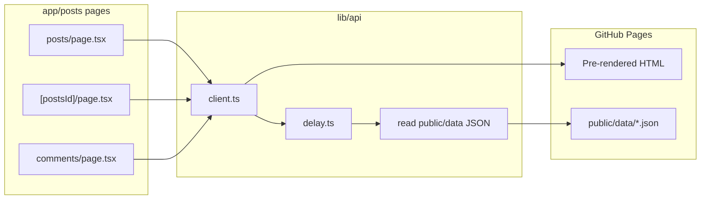

# Plan: In-App API Flow, Simulated Latency, and GitHub Pages + Actions

This document is the implementation roadmap for **next_js_learning**. It assumes **App Router only** (no `pages/` router, no `getServerSideProps`). Work through the phases in order; each phase has clear outcomes you can verify locally before deploying.

---

## 1. Goals

| Goal | Description |
|------|-------------|
| **API-style data flow** | Pages load data through a single layer (`lib/api`), as if calling a backend—not hardcoded arrays imported inside `page.tsx`. |
| **Everything in the repo** | **All data and “API” behavior live inside this repository.** Fixtures in `public/data/` (and types/helpers in `lib/api/`). No external HTTP APIs for posts or comments in this phase—**no JSONPlaceholder** (remove or stop using `API_BASE_URL` for remote calls when you migrate). |
| **Simulated latency** | Configurable in-app delay (`MOCK_DELAY_MS`) so you can practice loading states (`loading.tsx`, Suspense, optional Client Components). |
| **GitHub Pages** | Static HTML/JS/CSS hosted on `github.io` (project site or user site), served only from committed assets. |
| **GitHub Actions** | CI: lint + build; CD: publish the static export to GitHub Pages—builds must not depend on the public internet for data. |

### 1.1 Non-goals (for now)

- Calling **JSONPlaceholder** or any third-party REST API in dev, CI, or production.
- Live **Route Handlers** as a backend on GitHub Pages (static hosting has no server).
- Storing production secrets in the repo (`.env` is for local tuning only; commit `.env.example`, not secrets).

---

## 2. Constraints you must understand (read once)

### 2.1 GitHub Pages is static only

There is **no Node.js server** on GitHub Pages. That affects Next.js:

| Works on static export | Does not work on static export |
|------------------------|--------------------------------|
| Pre-rendered pages at **build** time | `Route Handlers` (`app/api/.../route.ts`) as live backends |
| **Client-side** `fetch` to static JSON under `/data/...` (same origin on GHP) | Server `fetch` on **each user request** (true SSR per visit) |
| `generateStaticParams` for known dynamic paths | Uncached dynamic routes that require server runtime |
| `loading.tsx` + client components for in-browser loading UX | Secrets in server-only env vars at runtime (there is no server) |

**Implication:** For GitHub Pages you will use **`output: 'export'`** in `next.config.ts` and design the “API” so data is either:

1. **Baked in at build time** (Server Components + `fetch`/`lib` during `next build`), and/or  
2. **Fetched in the browser** from files in `public/` (simulated API + artificial delay in client code).

A **simulated delay on the server during `next build`** only slows the build—it does **not** teach runtime loading UX on the live static site. For **visible** slow responses on GitHub Pages, use **client-side** fetch + `delay(ms)` or a small Client Component wrapper.

### 2.2 Your current config

- **`cacheComponents: true`** and **`partialPrefetching: true`** — optimized for full Next hosting (Vercel, Node). Static export may require relaxing or turning off some options; validate with `next build` after adding `output: 'export'`.
- **Comments** today may still call `process.env.API_BASE_URL` — **migrate** to `lib/api` reading only `public/data/*.json` (see Phase A).

### 2.3 In-repo mock API only

| Principle | Detail |
|-----------|--------|
| **Single source of truth** | JSON files under `public/data/` (and optionally TypeScript re-exports in `lib/api/mock/` that import those fixtures). |
| **No network data dependency** | `getPosts()`, `getPost()`, `getComments()` never call external hosts; CI and GitHub Pages builds work offline. |
| **API-shaped contract** | `lib/api/client.ts` exposes async functions that **behave** like HTTP clients (`delay`, errors, 404) but read local files. |
| **Future external API** | Out of scope for this plan; if added later, introduce a **new** module (e.g. `lib/api/remote.ts`) without mixing into the default mock path. |

---

## 3. Target architecture

```text
next_js_learning/
  app/
    layout.tsx                 # Root layout + nav (move MenuNavigation here when ready)
    posts/
      page.tsx                 # List — calls getPosts()
      [postsId]/
        page.tsx               # Detail — getPost(postsId)
        loading.tsx            # Optional skeleton
        comments/
          page.tsx             # Comments — getComments(postsId)
          loading.tsx
  lib/
    api/
      config.ts                # MOCK_DELAY_MS, paths to public/data
      delay.ts                 # export async function delay(ms)
      types.ts                 # Post, Comment (align with JSON + UI)
      client.ts                # getPosts, getPost, getComments
      mock/
        store.ts                 # Read from public/data/*.json OR imported fixtures
  public/
    data/
      posts.json
      posts/
        1.json
        1-comments.json        # Optional per-id files
  docs/
    PLAN_API_STATIC_DEPLOYMENT.md   # This file
  .github/
    workflows/
      ci.yml                   # Lint + build
      deploy-pages.yml         # Build static export → GitHub Pages
```

### 3.1 Data flow (mental model)



**Dev (full Next):** Server Components can call `client.ts` with delay + read JSON from disk or `fetch('/data/...')` with absolute URL helper.

**GitHub Pages:** Build pre-renders list/detail/comments where possible; for **runtime** delay UX on comments, use a Client Component that `fetch('/data/posts/1-comments.json')` after `await delay(800)`.

---

## 4. In-app “API” design (simulated calls + latency)

### 4.1 Environment variables

| Variable | Scope | Example | Purpose |
|----------|--------|---------|---------|
| `MOCK_DELAY_MS` | Build + client | `500` (local), `0` (CI) | Artificial latency inside `lib/api` |
| `NEXT_PUBLIC_BASE_PATH` | Client | `/next_js_learning` | GitHub **project** Pages base path (if needed client-side) |
| `GITHUB_PAGES` | Build only | `true` | Enables `output: 'export'` + `basePath` in config |

Use **no API keys** for this project. Remove unused `NEXT_PUBLIC_API_KEY` and **`API_BASE_URL`** from `.env` when migration is done (document replacements in `.env.example`).

**GitHub Actions:** set `MOCK_DELAY_MS=0` for faster builds; no network env vars required for data.

### 4.2 `lib/api/delay.ts`

```ts
export function delay(ms: number): Promise<void> {
  return new Promise((resolve) => setTimeout(resolve, ms));
}
```

### 4.3 `lib/api/client.ts` (behavior sketch)

- **`getPosts()`**  
  - `await delay(config.mockDelayMs)`  
  - Load `public/data/posts.json` (server: `fetch` with absolute URL helper in dev, or static `import`; client on GHP: `fetch` with basePath + `/data/posts.json`).

- **`getPost(id)`** — find in posts list or read `public/data/posts/{id}.json` if you split per-post files.

- **`getComments(postId)`** — read `public/data/posts/{postId}-comments.json` (or one consolidated `comments.json` filtered by `postId`).

- **Field names:** Define your own schema in `types.ts` (e.g. `title` + `content` on posts, or `body`—pick one and use it consistently in JSON fixtures and UI).

- **Errors:** throw or return `null`; pages call `notFound()` when appropriate.

### 4.4 Types (`lib/api/types.ts`)

Define types to match **your** committed JSON (example):

```ts
export type Post = { id: number; title: string; content: string };
export type Comment = { id: number; postId: number; name: string; email: string; body: string };
```

### 4.5 Showing latency in the UI

| Approach | Where delay runs | Good for GHP? |
|----------|------------------|---------------|
| Delay inside Server Component `getX()` | Build time (static) or server in `next dev` | Build-time delay = no user-visible wait on exported site |
| **`loading.tsx`** + async Server page | Streaming in dev/full host | Partially; static export still pre-renders fallback behavior at build |
| **Client Component** `useEffect` + `fetch('/data/...')` + `delay` | Browser | **Yes** — best for “spinner for 800ms” on GitHub Pages |

**Recommendation:** Implement **both** for learning:

1. Server path through `lib/api` (clean architecture, works in dev).  
2. Optional `CommentsListClient.tsx` for demonstrable slow load on static hosting.

### 4.6 Migrate existing code (checklist)

- [ ] Replace `app/data/posts.ts` usage in `posts/page.tsx` and `[postsId]/page.tsx` with `getPosts()` / `getPost()`.
- [ ] Replace raw `fetch` in `comments/page.tsx` with `getComments(postsId)`.
- [ ] Fix order: `response.ok` → then `json()` (you already fixed this on comments).
- [ ] Add `generateStaticParams` on `[postsId]` (and comments if nested) returning ids `1..N` from mock posts so static export knows which HTML files to emit.
- [ ] Add links: post detail → comments route.

---

## 5. Static export for GitHub Pages

### 5.1 `next.config.ts` additions (when you implement)

```ts
const isProdExport = process.env.GITHUB_PAGES === 'true';

const nextConfig: NextConfig = {
  output: isProdExport ? 'export' : undefined,
  // Project site: https://<user>.github.io/<repo>/
  basePath: isProdExport ? '/next_js_learning' : '',
  assetPrefix: isProdExport ? '/next_js_learning/' : '',
  images: { unoptimized: true }, // required for image optimization without server
  // Re-evaluate cacheComponents with static export; disable if build fails
};
```

Adjust `basePath` / `assetPrefix` to match your **GitHub repository name**.

### 5.2 Images and `next/link`

- Use `next/image` only with `unoptimized: true` for static export, or plain ``.
- With `basePath`, `next/link` and `next/image` usually respect config; test all nav links after export.

### 5.3 Dynamic routes

For `app/posts/[postsId]/page.tsx`:

```ts
export async function generateStaticParams() {
  const posts = await getPosts();
  return posts.map((p) => ({ postsId: String(p.id) }));
}
```

Without this (or without `dynamicParams: false` + complete params list), static export may omit routes or error.

### 5.4 `next dev` vs static export

Keep normal `next dev` **without** `output: 'export'` for daily learning. Use `GITHUB_PAGES=true npm run build` locally to mimic CI before pushing.

Add script:

```json
"build:gh-pages": "GITHUB_PAGES=true next build"
```

---

## 6. GitHub Actions

### 6.1 Repository settings (one-time)

1. GitHub repo → **Settings** → **Pages** → Source: **GitHub Actions**.
2. Ensure default branch is `main` (or match workflow).

### 6.2 Workflow: CI (`/.github/workflows/ci.yml`)

**Triggers:** `push` and `pull_request` to `main`.

**Steps:**

1. Checkout  
2. Setup Node **≥ 20.9** (required by Next 16; match README note if local Node is 18).  
3. `npm ci`  
4. `npm run lint`  
5. `npm run build` (full Next build, no export required on every PR—or run `build:gh-pages` to catch export errors early).

### 6.3 Workflow: Deploy Pages (`/.github/workflows/deploy-pages.yml`)

**Triggers:** `push` to `main` (optional: `workflow_dispatch`).

**Steps:**

1. Checkout  
2. Setup Node 20+  
3. `npm ci`  
4. Env:  
   - `GITHUB_PAGES=true`  
   - `MOCK_DELAY_MS=0`  
5. `npm run build:gh-pages`  
6. Upload artifact: **`out/`** (Next static export output directory)  
7. Deploy with official action: `actions/upload-pages-artifact` + `actions/deploy-pages`  
   - Permissions: `contents: read`, `pages: write`, `id-token: write`

Reference: [Next.js static export](https://nextjs.org/docs/app/building-your-application/deploying/static-exports) and [GitHub Pages from Actions](https://docs.github.com/en/pages/getting-started-with-github-pages/configuring-a-publishing-source-for-your-github-pages-site#publishing-with-a-custom-github-actions-workflow).

### 6.4 Monorepo / fork notes

- If the repo is **user/org site** (`<user>.github.io` repo), `basePath` is often **empty**, not `/repo-name`.
- Document the chosen URL in README after first deploy.

---

## 7. Phased implementation plan

### Phase A — API layer (local only)

**Outcome:** All post/comment pages use `lib/api`; data from `public/data/*.json`; delay in `client.ts`.

| Task | Verify |
|------|--------|
| Create `lib/api/*` and JSON fixtures | Unit smoke: `getPosts()` returns array |
| Wire `posts/page.tsx`, `[postsId]/page.tsx`, comments page | `/posts`, `/posts/1`, `/posts/1/comments` |
| Add `loading.tsx` where useful | Slow delay in dev shows fallback |
| Remove or deprecate `app/data/posts.ts` | Single source of truth |

### Phase B — Static export proof

**Outcome:** `out/` folder serves locally via `npx serve out`.

| Task | Verify |
|------|--------|
| Add `output: 'export'`, `basePath`, `images.unoptimized` | `npm run build:gh-pages` succeeds |
| Add `generateStaticParams` for all mock ids | All post URLs exist as HTML in `out/` |
| Fix `cacheComponents` if build fails | Document final config in README |

### Phase C — Client-side latency demo (optional but recommended for GHP)

**Outcome:** On static site, comments (or list) show spinner then data.

| Task | Verify |
|------|--------|
| Client component + `fetch` relative `/data/...` + `delay` | Throttle CPU/network in DevTools; spinner visible |
| Keep Server path for same data in `next dev` | Both modes work |

### Phase D — GitHub Actions

**Outcome:** Push to `main` → green CI → site updates.

| Task | Verify |
|------|--------|
| Add `ci.yml` and `deploy-pages.yml` | Actions tab green |
| Open published URL with `basePath` | Links and assets load |

### Phase E — Polish

- README: dev setup, env vars, deploy URL, architecture diagram link to this doc.  
- `not-found` on all segments; consistent `MenuNavigation` in root layout.  
- README badge for workflow status (optional).

---

## 8. Testing matrix

| Scenario | Command / action |
|----------|------------------|
| Dev server API flow (slow) | `MOCK_DELAY_MS=800 npm run dev` |
| Dev server API flow (fast) | `MOCK_DELAY_MS=0 npm run dev` |
| Static bundle | `npm run build:gh-pages && npx serve out` |
| Invalid post | `/posts/999` → `notFound` |
| CI locally | `npm run lint && npm run build` |

---

## 9. Risks and mitigations

| Risk | Mitigation |
|------|------------|
| Next 16 + `cacheComponents` + static export incompatibility | Try export early; disable flags if documented in build error |
| Node 18 in CI | Use `node-version: 22` in Actions |
| Wrong `basePath` → broken CSS/JS | Single source: env + config; test with `serve out` |
| Broken relative `/data/...` fetch on GHP | Prefix with `basePath` or use `next/link` asset paths; test after export |
| Duplicate route folders `[id]` vs `[postsId]` | Keep one dynamic segment name repo-wide |

---

## 10. What “done” looks like

1. **Architecture:** No page imports `app/data/posts.ts` directly; all data via `lib/api`.  
2. **Latency:** Configurable `MOCK_DELAY_MS`; visible loading on static site via client path.  
3. **Deploy:** Public GitHub Pages URL serves the demo; Actions deploy on merge to `main`.  
4. **Learning:** You can explain App Router data loading, static export limits, and why `getServerSideProps` is not used.

---

## 11. References (read in this order)

1. Next.js static export — `node_modules/next/dist/docs/` (deploying / static exports).  
2. `generateStaticParams` — same docs tree.  
3. GitHub Pages + Actions — GitHub Docs “custom GitHub Actions workflow” for Pages.

---

## 12. Next action (start here)

1. Create `public/data/posts.json` and comment fixtures (e.g. `public/data/posts/1-comments.json`)—author JSON by hand or export once then **commit only repo copies**.  
2. Implement `lib/api/config.ts`, `delay.ts`, `types.ts`, `client.ts` (in-repo reads only).  
3. Switch **one** page (`comments/page.tsx`) to `getComments()` and remove `API_BASE_URL` fetch.  
4. Migrate posts list and detail; remove `app/data/posts.ts` when fixtures + client are ready.  
5. Add `.env.example` with `MOCK_DELAY_MS` and `GITHUB_PAGES` only—no external API URL.  
6. Then add `output: 'export'` and GitHub workflows.

*Document version: 1.1 — in-repo mock API only; no JSONPlaceholder. App Router, Next 16.4.x, `app/posts/[postsId]/...`.*
